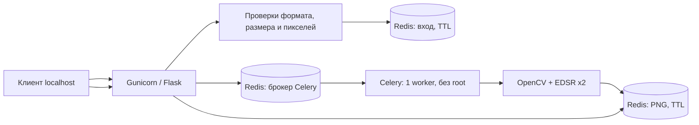

# Upscale Service — асинхронный апскейлинг изображений

Учебный backend-сервис на **Flask, Gunicorn, Celery, Redis и OpenCV EDSR ×2**. Принимает изображение, ставит задачу на обработку и выдаёт готовый PNG по временной ссылке.

**Статус:** локальное демонстрационное приложение. **Не готово для публичного доступа в интернет**: отсутствуют аутентификация, rate limiting, пользовательские квоты и независимая приёмка безопасности нативного декодера/EDSR.

## Архитектура



API и worker используют единые ограничения загружаемого изображения. Redis не публикует порт на хост; контейнеры общаются по внутренней Compose-сети. Это локальная изоляция сети, **не замена авторизации Redis при развёртывании в иной инфраструктуре**.

## Ограничения загрузки

| Проверка | Правило | HTTP |
|---|---|---|
| Нет multipart-поля `file` | Загрузка не принимается | 400 |
| Недопустимые байты или повреждённое изображение | Проверка Pillow до OpenCV | 400 |
| Расширение не поддерживается | PNG, JPEG, BMP, TIFF (включая `.tif`) | 415 |
| Расширение не соответствует реальному формату | Определяется по содержимому, не по заголовку клиента | 400 |
| Больше 8 МиБ | Ограничены тело запроса и байты файла | 413 |
| Более 4 млн пикселей или сторона свыше 4096 | Проверка метаданных до декодирования и в worker | 413 |
| Redis/Celery недоступен | Без внутренних реквизитов и stack trace | 503 |

Форматы ограничены намеренно. Ограничения настраиваются переменными `MAX_IMAGE_BYTES`, `MAX_IMAGE_PIXELS`, `MAX_IMAGE_SIDE`; значения по умолчанию указаны в таблице. Каждая обработка EDSR ×2 может расходовать заметно больше RAM, чем размер сжатого файла.

Временные данные имеют TTL 3600 секунд. Файлы не сохраняются приложением в постоянное хранилище; **Werkzeug может временно размещать multipart-данные в `/tmp`** (для Docker это ограниченный tmpfs). Redis запущен без AOF и snapshot persistence; это не durable job store. При отказах инфраструктуры задания могут быть потеряны.

## Быстрый старт — только локальный стенд

```bash
git clone https://github.com/bsekinaev/upscale_service.git
cd upscale_service
docker compose up --build -d
```

HTTP слушает только `127.0.0.1:5000`; наружу Redis не публикуется.

```bash
curl -X POST -F "file=@input.png" http://127.0.0.1:5000/upscale
# {"task_id":"...uuid-v4..."}

curl http://127.0.0.1:5000/tasks/<task_id>
# {"status":"PENDING"} либо {"status":"SUCCESS","download_url":"/processed/<task_id>"}

curl -o upscaled.png http://127.0.0.1:5000/processed/<task_id>
```

Проверка живого HTTP-процесса: `GET /healthz` → `{"status":"ok"}`. Это только **liveness**, не подтверждение готовности Redis, EDSR и почтовой/внешней инфраструктуры.

Для остановки локального стенда: `docker compose down`.

## API

| Метод | Путь | Результат |
|---|---|---|
| POST | `/upscale` | `202`, UUID задачи |
| GET | `/tasks/<task_id>` | Статус без внутреннего текста исключений |
| GET | `/processed/<task_id>` | PNG, либо `202` если обработка продолжается |
| GET | `/healthz` | HTTP liveness |

Идентификаторы задач проверяются как канонические UUIDv4. У API нет пользовательских учётных записей: **любой клиент, узнавший UUID, сможет получить результат до истечения TTL**. Не открывайте порт публично без отдельной аутентификации и защиты от злоупотреблений.

Ошибки обработки возвращаются как `processing_failed`, без содержимого внутренних исключений. Сбои постановки задачи логируются с типом ошибки, без соединительных строк, и возвращают `503`; удаление входа после такого сбоя — best effort. Публикация Celery-сообщения и запись в Redis не атомарны.

## Тесты и границы проверок

```bash
python -m pip install -r requirements.txt
python -m pytest tests/ -q
```

Тесты используют **подменные объекты Redis в памяти** и Celery eager backend. Они не вызывают `FLUSHDB` и не подключаются к реальному Redis. В pytest нейросеть EDSR заменена безопасным mock; проверяются размеры, формат, ошибочные байты, UUID, Celery-отказы, очистка и отсутствие утечек в HTTP-ответах.

GitHub Actions дополнительно собирает Docker-образ, поднимает одноразовый Compose и проверяет Gunicorn, непривилегированный UID контейнеров, доступность localhost API и отсутствие открытого порта Redis. **Реальное качество изображения и производительность EDSR на большом потоке не подтверждаются этим CI** — это отдельные E2E/нагрузочные проверки.

## Безопасность и эксплуатационные границы

- Gunicorn вместо Flask dev server; непривилегированный пользователь UID 10001 у Flask и Celery.
- Для рабочих контейнеров включены `read_only`, `no-new-privileges`, сброс Linux capabilities, ограниченный tmpfs; worker запускается с concurrency=1.
- Redis в отдельной внутренней сети, без опубликованного порта, без записи snapshot/AOF и с лимитом памяти. Разделение Redis DB0/DB1/DB2 — **логическое, не криптографическая изоляция**.
- Контейнерная защита снижает риск, но OpenCV/Pillow обрабатывают недоверенные файлы: публичная эксплуатация требует отдельной оценки угроз, авторизации, лимитов запросов и наблюдаемости.
- `EDSR_x2.pb` включён в исторический репозиторий. Лицензия MIT в корне относится к авторскому коду; **условия распространения весов EDSR отдельно не подтверждены**. До коммерческого использования или переупаковки модели проверьте происхождение и лицензию весов.

## План развития

- [x] Асинхронный API, Celery, Redis, OpenCV EDSR ×2
- [x] Валидация реального формата и ограничение размера/пикселей
- [x] Безопасные ошибки, лимиты Docker, непривилегированный worker
- [x] Регрессионные offline-тесты и первичный Docker smoke
- [ ] GH-07: расширенный CI, реальные изолированные Redis/Celery integration и EDSR smoke
- [ ] Разобрать права на поставку `EDSR_x2.pb`
- [ ] Авторизация, пользовательские квоты, rate limiting и мониторинг для публичного размещения
